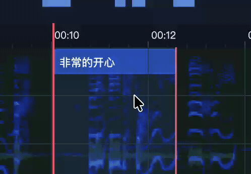

<p align="center">
  
</p>

<h1 align="center">AegiNext</h1>

<p align="center">Modern, native cross-platform subtitle creation</p>

<p align="center">
  <a href="README.md">English</a> · <a href="README.zh-CN.md">简体中文</a>
</p>

<p align="center">
  <a href="docs/en/quick-start.md">Quickstart</a> ·
  <a href="docs/en/README.md">English Docs</a> ·
  <a href="docs/zh-cn/README.md">中文文档</a>
</p>

AegiNext makes subtitle creation easier to learn, supports Aegisub file standards, and runs natively on macOS and Windows. Its goal is to succeed the original Aegisub after its author stopped maintaining it, carrying the subtitle creation workflow forward.


## Features

- **Subtitle creation**: multiple tracks, waveform and spectrogram timing, and ASS/SRT import and export.
- **ONNX smart snapping**: a local audio model predicts subtitle boundaries for clip dragging, trimming, and classic mouse timing.
- **Styles and effects**: rich text, karaoke, keyframes, motion paths, masks, and reusable scripts.
- **Modern workspace**: dockable panels, light and dark themes, English, Simplified Chinese and Japanese interfaces, and custom shortcuts.
- **Saving and export**: autosave, backup recovery, burned-in video/HDR export, and switchable subtitles embedded in MKV/MP4 without re-encoding audio or video.

## Quickstart

1. Open the app, create a project, and load media with **File → Open Video**.
2. Select a track, press **F8 / F9** to mark subtitle start and end, then enter the text.
3. Adjust its style, save with **Cmd/Ctrl + S**, and export subtitles through **Format** or video through **Encoding**.

For broad video compatibility, select **Settings → Media → Auto** decoding. macOS negotiates VideoToolbox support for the actual codec/profile, including HEVC 4:2:2/4:4:4, AV1, VP9, and ProRes 422/4444 on capable devices, while preserving source precision, chroma, and Alpha. Unsupported hardware inputs fall back to CPU. ProRes Alpha composites onto black; **GPU (strict)** requires confirmed hardware acceleration without fallback. See [media compatibility](docs/en/media.md).

## ONNX smart snapping

Koumori analyzes audio locally through ONNX Runtime, predicting subtitle boundaries using timing conventions learned from corrected subtitles. Smart snapping aligns clips with model candidates as you move them or trim either edge. It also works with classic Aegisub mouse timing.

1. In **Settings → Automatic timing**, select **Enable the local timing model** and use an available built-in model or manually specify a complete model directory.
2. Open media with an audio track and let background analysis prepare snap candidates. Follow progress or cancel in the task center while continuing to edit.
3. Enable **Smart snapping**, the magic-wand button in the timeline toolbar, then drag a subtitle clip or either edge.

Starts snap to model starts, and ends snap to model ends. The maximum snap distance defaults to **250 ms** and is adjustable in automatic timing settings; snapping is also limited to **8 pixels** on the timeline. Hold **Alt** to temporarily disable snapping. See [subtitle editing](docs/en/subtitle-editing.md#timeline-clip-timing) for more timeline controls.



## Aegisub compatibility

The following classic Aegisub audition shortcuts and mouse timing controls are supported. Check **Settings → Shortcuts** for your current key bindings.

| Default key / mouse | Action |
|---|---|
| Q | Audition a short range before the subtitle starts |
| W | Audition a short range after the subtitle ends |
| E | Audition a short range from the subtitle's start |
| R | Audition the whole subtitle |
| Left click in the timeline body | Set the primary selected subtitle's start at the clicked time |
| Right click in the timeline body | Set the primary selected subtitle's end at the clicked time |

Q/W/E/R work with Timeline or a subtitle row focused, outside text editing. Short ranges default to **500 ms**, configurable in **Settings → Preview**.

For mouse timing, select a subtitle and enable **Classic Aegisub timing** using the mouse icon at the timeline's bottom left; it is off by default. While enabled, left and right clicks in the body edit the primary selected subtitle without changing selection. Turn it off to restore normal selection, dragging, and clip context menus. See the [shortcut guide](docs/en/quick-start.md#classic-aegisub-controls).

## Subtitle and project formats

| Format | Preserved content | Access |
|---|---|---|
| ASS (`.ass`) | Base/local styles, left/right/vertical margins, karaoke, static positioning, and supported masks | Format → Aegisub → Import / Export |
| SRT (`.srt`) | Subtitle text and start/end times | Format → SRT → Import / Export |
| AegiNext project (`.aeginext`) | Project data, tracks, styles, effects, and media references | File → Open Project / Save / Save As |

Imports create independent tracks; overlapping cues keep their times on additional tracks. Exports include all subtitle tracks. Save an `.aeginext` project to continue editing.

Supported ASS `\move`, `\fad`, and `\fade` animation converts to editable native tracks. Unsupported tags or animation require confirmation before import conversion. SRT export reports loss of rich styling, karaoke, masks, and animation. See [subtitle import and export](docs/en/subtitle-editing.md#import-and-export) for the full supported scope.

`aegnc` ships with the application to convert ASS/SRT/project subtitles and export project video, with interactive wizards and script options. See the [command-line guide](docs/en/cli.md).

## Run from source

Install the .NET SDK and PowerShell required by the repository. Run the following commands from its root.

### Install dependencies

Native SDKs are installed into the ignored project `.dependencies/` directory with locked versions and SHA256 verification. Build tools use Homebrew on macOS and Scoop on Windows. For Windows release packaging, also install NSIS:

```powershell
scoop bucket add extras
scoop install nsis
```

Prepare locked project SDKs, install missing build tools, and build the workbench:

```powershell
pwsh -NoProfile -File ./build.ps1 -Target Workbench -InstallDependencies
```

### Build

For subsequent builds:

```powershell
pwsh -NoProfile -File ./build.ps1 -Target Workbench -Configuration Release
```

### Release

```powershell
pwsh -NoProfile -File ./release.ps1
```

Run on the target OS to create a macOS DMG or Windows NSIS installer. Packages are written to a new directory under `artifacts/releases/`.

See [Building](docs/en/building.md) for setup, launching, and debugging, or [Publishing](docs/en/publishing.md) for packaging.

## License

GPLv3.
